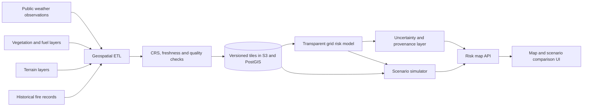

# EmberSight

**Development Status: In Progress**

Wildfire risk and response simulation. This repository currently contains design documentation only. The architecture and features below are proposed; no application implementation is claimed.

## Overview

A wildfire intelligence prototype for mapping risk and comparing simulated response scenarios.

## Problem

Wildfire planning combines weather, terrain, vegetation, and reports with different update rates. A single unexplained risk score can mislead decision makers.

## Proposed solution

Fuse documented public data into a transparent grid risk model, show uncertainty and source timestamps, and let users compare simulated response scenarios. Outputs are planning demonstrations, not operational incident guidance.

## Proposed tech stack

Python, GeoPandas, rasterio, PostGIS, FastAPI, AWS S3, Lambda or batch jobs, Leaflet/MapLibre, Docker; optional public weather and fire-perimeter datasets.

## Proposed architecture

The [architecture](architecture.md) explains the data flow and boundaries. The [technical design](technical-design.md) defines the first build and evaluation approach.

## Development roadmap

See the [phased development roadmap](development-roadmap.md). It describes planned work without implying that any phase is complete.
