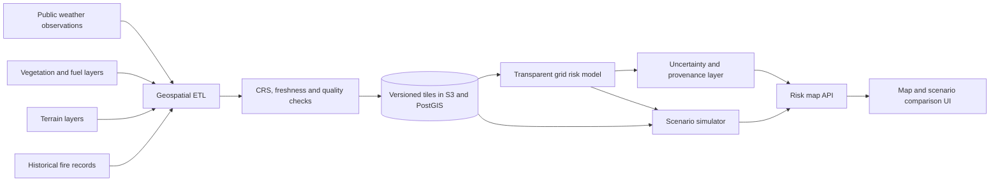

# EmberSight architecture

**Development Status: In Progress** — proposed design, not a deployed system.

## System diagram

## Data flow and boundaries

### Spatial contract
Normalize inputs to one coordinate reference system, resolution, and timestamp convention. Each tile records source, version, refresh time, missing-data mask, and transformation steps.

### Risk model
Use a transparent weighted baseline over fuel, slope, and recent weather. Keep the weights and data date visible. Missing inputs lower confidence; they must not silently become zero risk.

### Scenario model
Compare user-selected simulated interventions under the same weather and ignition assumptions. Show sensitivity to changed assumptions. The MVP does not predict exact fire spread or recommend evacuation.

## Security and operating boundaries

Use public or licensed data with attribution, validate geospatial uploads, control external API costs, and prominently label simulated outputs and uncertainty.

## Initial deployment approach

Build the smallest local or low-cost proof of concept first. Introduce managed cloud services only after the data contracts and baseline evaluation work locally. Record configuration, dataset versions, and costs so results can be reproduced.
